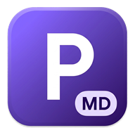

<div align="center">
  
  <h1>Pilgrim Markdown</h1>
  <p><strong>Fast, offline-first Material Design 3 Markdown editor PWA for ChromeOS and desktop browsers.</strong></p>

  <p>
    <a href="https://inectha.github.io/Pilgrim-Markdown/">
      
    </a>
  </p>

  <p>
    <a href="https://github.com/Inectha/Pilgrim-Markdown/actions/workflows/deploy.yml">
      
    </a>
    <a href="https://github.com/Inectha/Pilgrim-Markdown/releases">
      
    </a>
    <a href="./LICENSE">
      
    </a>
    <a href="./TRADEMARKS.md">
      
    </a>
    
    
  </p>
</div>

---

## Live App & Installation

Open **[https://inectha.github.io/Pilgrim-Markdown/](https://inectha.github.io/Pilgrim-Markdown/)** in Chrome or Edge and click the **Install** icon in the address bar.

- **ChromeOS / Chromebooks:** Installs as a native-feeling app with its own Launcher & Shelf icon, Window Controls Overlay, and automatic `.md` / `.markdown` / `.txt` association in the ChromeOS **Files** app (local storage & Google Drive mount).
- **School / Managed Chromebooks (Google Admin Console):** Admins can deploy it across student Chromebooks via *Devices → Chrome → Apps & extensions → Add by URL* using `https://inectha.github.io/Pilgrim-Markdown/`.

## Features

- **100% Offline & Privacy-First:** No accounts, no servers, no telemetry, and no external CDN requests. Fully precached via Service Worker (`vite-plugin-pwa`).
- **Beginner-Friendly & Fast:** Type `/` anywhere for **slash-command autocompletion**, press `Ctrl+/` (or `Ctrl+Shift+P`) for the **Command Palette**, or press `F1` for the searchable **Help & Cheat Sheet** with one-click snippet insertion.
- **Powerful Editor & Live Preview:** CodeMirror 6 with Smart Link Paste, synchronized scrolling (`data-source-line`), clickable task lists, copy buttons on code blocks, YAML frontmatter cards, clickable Document Outline (`H1–H3`), and lazy-loaded KaTeX math.
- **Accessible by Design:** Keyboard-navigable UI, focus-trapped modals, ARIA roles, and high-contrast Material Design 3 light & dark themes.
- **Secure by Design:** Strict Content Security Policy (CSP) and HTML sanitization via `DOMPurify`.
- **Crash Recovery & Conflict Detection:** Multi-window-safe IndexedDB drafts using the Web Locks API and external file modification checks (`lastModified`) before overwriting.
- **Export & Clipboard:** Save directly to `.md`, export as standalone `.html` (with embedded CSS and native MathML), print to PDF (`@media print`), and one-click **Copy for Google Docs / Gmail**.

## Key Shortcuts

| Shortcut | Action |
| :--- | :--- |
| `/` | Open inline Markdown slash-command menu |
| `Ctrl+/` or `Ctrl+Shift+P` | Open Command Palette |
| `F1` | Open searchable Help & Cheat Sheet |
| `Ctrl+S` / `Ctrl+Shift+S` | Save / Save As |
| `Ctrl+O` | Open file |
| `Ctrl+B` / `Ctrl+I` / `Ctrl+K` | Bold / Italic / Insert link |

## Development

```bash
npm install
npm run dev
```

## Quality Checks & Build

```bash
npm run typecheck
npm run lint
npm test
npm run build
```

See [BLUEPRINT.md](./BLUEPRINT.md) for the full technical architecture.

## License & Trademarks

- **Source code:** Licensed under the [MIT License](./LICENSE).
- **Names & Brand Assets (`Pilgrim Software`, `Pilgrim Markdown`, `Pilgrim MD`, and all logos/icons):** Copyright © 2026 Pilgrim Software — All Rights Reserved. See [TRADEMARKS.md](./TRADEMARKS.md). Forks and redistributions must use their own name and branding.
